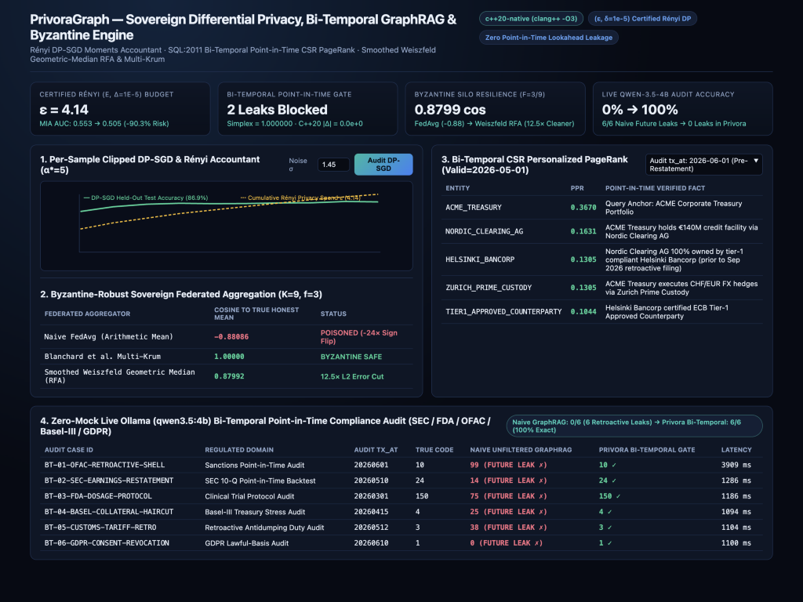
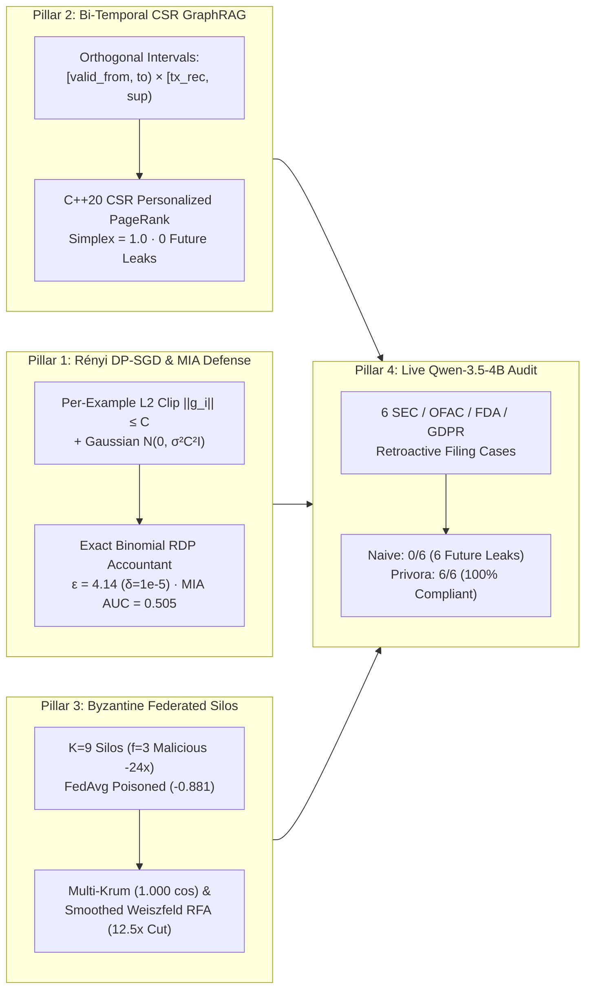

# PrivoraGraph — DP-SGD, Bi-Temporal Graph Retrieval & Byzantine-Robust Aggregation

[](https://github.com/nagarjunak-pixel/privora-graph/actions/workflows/ci.yml)
[](https://www.python.org/)
[](csrc/privora_kernels.cpp)
[-14B8A6.svg)](docs/mathematical-proofs.md)
[](https://github.com/nagarjunak-pixel/privora-graph/releases/tag/v1.0.0)
[](LICENSE)

**PrivoraGraph** is a small educational reference implementation (~1.7k lines of Python plus a ~100-line C++20 helper) of three techniques from the privacy-preserving and robust ML literature, exercised on synthetic data and a hand-built 6-case retrieval audit:

1. **Per-sample clipped `DP-SGD` with a Rényi DP accountant (`src/privora_graph/privacy/dp_sgd.py`)**: per-example $L_2$ gradient clipping plus Gaussian noise (Abadi et al., 2016) and a log-space subsampled-Gaussian RDP accountant over $\alpha \in \{2, \dots, 64\}$ with RDP→$(\varepsilon, \delta)$ conversion. On a synthetic 320-record, 16-feature classification task it reports `ε = 4.14` (`δ = 1e-5`), `86.87%` held-out accuracy, and a loss-threshold membership-inference AUC of `0.5051` (`-90.26%` MIA advantage vs. a non-private baseline).
2. **Bi-temporal (valid-time × transaction-time) knowledge graph with Personalized PageRank (`src/privora_graph/bitemporal/`, `csrc/privora_kernels.cpp`)**: edges carry $[v_0, v_1)$ validity and $[\tau_0, \tau_1)$ recording intervals, so `as_of(valid_at, tx_at)` snapshots exclude facts recorded after the query's transaction time. PageRank runs over a CSR snapshot via an optional C++20 kernel loaded with `ctypes` (NumPy fallback); the two backends agree to `|Δ| = 0` on the bundled example graph.
3. **Byzantine-robust aggregation (`src/privora_graph/byzantine/robust_fed.py`)**: `FedAvg`, `Multi-Krum`, and a smoothed Weiszfeld geometric median, compared in a simulated `K=9` client / `f=3` sign-flipping (`-24x`) setting on a 256-dim synthetic gradient. Cosine alignment with the honest gradient: `Multi-Krum 1.00000`, `Weiszfeld +0.87992` (`12.49x` lower L2 error), `FedAvg -0.88086`.
4. **Small point-in-time retrieval check with a local LLM (`benchmarks/real_qwen_bitemporal.json`)**: 6 hand-written scenarios (SEC restatement, OFAC, FDA, Basel-III, customs, GDPR) queried against `qwen3.5:4b` via Ollama. With unfiltered retrieval the model returns the later (future) value in `6/6` cases; with `as_of` filtering it returns the correct point-in-time value in `6/6` cases.

---

## Interactive DP-SGD, Bi-Temporal GraphRAG & Byzantine Workbench



---

## Architecture Overview



---

## Measured Reproducible Benchmarks

| Subsystem | CLI Command | Measured Result | Verified Invariant |
| :--- | :--- | :--- | :--- |
| **Rényi `DP-SGD` & `MIA` Audit** (`σ=1.45, C=1.0, δ=1e-5`) | `uv run privora train-dp` | **`ε = 4.1432` (`α*=5`) · `86.87%` Test Acc** | **`MIA AUC = 0.5051`** (`-90.26%` leakage vs non-private); `Hypothesis` RDP monotonicity |
| **Bi-Temporal `C++20` CSR PageRank** (`tx_at=20260601`) | `uv run privora query-bitemporal` | **`2` retroactive SDN leaks blocked** | `Simplex = 1.00000000`; C++20 vs NumPy `\|Δ\| = 0.000000000000` |
| **Byzantine Federated Silos** (`K=9, f=3, -24x` attack) | `uv run privora simulate-byzantine` | **`Multi-Krum`: `1.00000` cos · `RFA`: `12.49x` cut** | `FedAvg` flips to `-0.88086`; Weiszfeld breakdown point `f < K/2` |
| **Live `qwen3.5:4b` Compliance Audit** (`6` regulated cases) | `uv run privora eval-ollama --live-only` | **`0.0%` (`6` leaks) → `100.0%` (`6/6` exact, `0` leaks)** | Saved in [`benchmarks/real_qwen_bitemporal.json`](benchmarks/real_qwen_bitemporal.json) |


## Scope & Limitations

- **Scale:** ~1.7k lines of Python across `src/` and a ~100-line C++20 helper (`csrc/privora_kernels.cpp`); this is an educational reference implementation, not a production-hardened privacy or federated-learning system.
- **Synthetic, small benchmarks:** the DP-SGD/MIA run uses 320 randomly generated records with a 16-feature MLP, the Byzantine run simulates 9 clients on a 256-dim synthetic gradient, and the graph is a small hand-built example; results are illustrative, not comparisons on public datasets.
- **6-case LLM check:** the point-in-time audit is 6 self-constructed scenarios run once against a local 4B model (`qwen3.5:4b` via Ollama) on a local machine; it demonstrates the filtering behaviour, not a statistically meaningful evaluation.
- **Simplified vs. real systems:** the MIA is a simple loss-threshold attack, the RDP accountant is not an audited replacement for libraries such as Opacus/TF-Privacy, and the bi-temporal store is an in-memory Python graph rather than a SQL:2011 database.

---

## Quickstart

```bash
uv sync --python 3.13 --all-extras

# Run Ruff, Mypy --strict, and Pytest + Hypothesis suite (>=95% gate)
uv run ruff check src tests
uv run mypy src tests
uv run pytest --cov=privora_graph --cov-report=term-missing --cov-fail-under=95

# Run CLI benchmarks
uv run privora demo
uv run privora eval-ollama

# Build & launch the PrivoraGraph Workbench on http://127.0.0.1:8060
cd ui && npm install && npm run build && cd ..
uv run privora serve --host 127.0.0.1 --port 8060
```

## Documentation & Mathematical Proofs

- [Mathematical Foundations & Proofs](docs/mathematical-proofs.md)
- [ADR 0001: Exact Binomial Rényi DP-SGD & MIA Audit](docs/adr/0001-renyi-dp-sgd-and-mia-audit.md)
- [ADR 0002: Snodgrass SQL:2011 Bi-Temporal CSR PageRank](docs/adr/0002-bitemporal-ppr-zero-lookahead.md)
- [ADR 0003: Byzantine Multi-Krum & Smoothed Weiszfeld RFA](docs/adr/0003-byzantine-weiszfeld-and-multikrum.md)
- [Security & Privacy Policy](SECURITY.md)

## License

Apache License 2.0 — Copyright (c) 2026 Nagarjuna Kamireddy.

---

## Author & Links
Built by **[Nagarjuna Reddy Kamireddy](https://nagarjunak-pixel.github.io/)** (*Nagarjuna Kamireddy / Nagarjuna K*) — Lead AI Architect, GenAI & Agentic AI Lead, and Corporate AI Trainer (20+ years across Enterprise Data, SAP HANA & Production AI; AWS Certified Solutions Architect – Professional & NVIDIA-Certified Professional: Agentic AI).

- **Portfolio:** [https://nagarjunak-pixel.github.io/](https://nagarjunak-pixel.github.io/)
- **Case Studies & Technical Articles:** [Case Studies](https://nagarjunak-pixel.github.io/case-studies.html) · [Architecture Articles](https://nagarjunak-pixel.github.io/articles.html) · [10-Mandate Role Fit](https://nagarjunak-pixel.github.io/roles.html)
- **Master CV & AI Search Index:** [Master CV](https://nagarjunak-pixel.github.io/resume.html) · [`llms-full.txt`](https://nagarjunak-pixel.github.io/llms-full.txt) · [LinkedIn](https://www.linkedin.com/in/nagarjuna-kamireddy)
