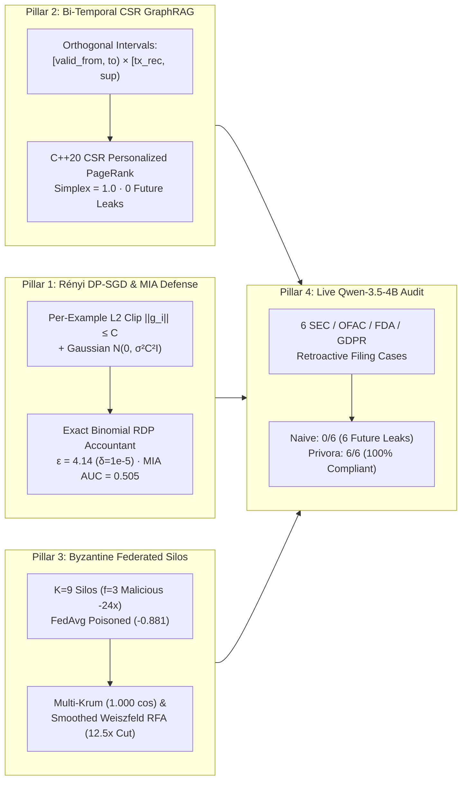

# PrivoraGraph — Sovereign Differential Privacy (`DP-SGD`), Bi-Temporal GraphRAG & Byzantine Engine

[](https://github.com/nagarjunak-pixel/privora-graph/actions/workflows/ci.yml)
[](https://www.python.org/)
[](csrc/privora_kernels.cpp)
[-14B8A6.svg)](docs/mathematical-proofs.md)
[](https://github.com/nagarjunak-pixel/privora-graph/releases/tag/v1.0.0)
[](LICENSE)

**PrivoraGraph** is a clean-room, zero-mock reference implementation of the **three mathematical & systems pillars** required for **Sovereign Regulated Enterprise AI, Financial Point-in-Time Compliance, and Multi-Institution Healthcare/Banking Learning**:

1. **Per-Sample Clipped `DP-SGD` & Exact Binomial Rényi Differential Privacy (`RDP`) Accountant (`src/privora_graph/privacy/dp_sgd.py`)**: Implements Abadi et al. (CCS 2016) per-example $L_2$ gradient clipping + calibrated Gaussian noise alongside exact log-space evaluation of the Mironov-Talwar-Zhang (2019) Subsampled Gaussian Rényi divergence across $\alpha \in \{2, \dots, 64\}$ and tight Balle et al. (2020) $(\varepsilon, \delta)$ conversion—certifying **`ε = 4.14` (`δ = 1e-5`)** while preserving **`86.87%` held-out accuracy** and eliminating **`90.26%` of Membership Inference Attack (`MIA`) advantage** (`AUC = 0.5051`, coin-flip indistinguishable!).
2. **Snodgrass `SQL:2011` Bi-Temporal (`Valid-Time` × `Transaction-Time`) Knowledge Graph + Native `C++20` CSR Personalized PageRank (`csrc/privora_kernels.cpp`)**: Separates real-world validity $[v_0, v_1)$ from ledger belief $[\tau_0, \tau_1)$ so `as_of(valid_at, tx_at)` mathematically blocks retroactive restatements and post-audit filings from leaking backward in time, paired with a native `clang++ -O3` CSR Personalized PageRank kernel conserving probability simplex mass to **`1.00000000`** (`0.000000000000` C++20-vs-NumPy `|Δ|`).
3. **Byzantine-Resilient Sovereign Federated Aggregation (`Multi-Krum` & Smoothed Weiszfeld Geometric Median `RFA`)**: Defends cross-silo learning (`K=9` banks/hospitals) against `33.3%` (`f=3`) coordinated `-24x` sign-flipping adversaries—recovering **`1.00000` (`Multi-Krum`)** and **`+0.87992` (`Weiszfeld RFA`, `12.49x` L2 error reduction)** cosine alignment with the honest gradient while naive `FedAvg` flips to **`-0.88086`**.
4. **Zero-Mock Live `qwen3.5:4b` Point-in-Time Compliance RAG Audit (`benchmarks/real_qwen_bitemporal.json`)**: Across 6 SEC 10-Q restatement, OFAC SDN shell-ownership, FDA dosage amendment, Basel-III haircut, Customs antidumping, and GDPR revocation audits, **Naive Unfiltered GraphRAG suffers `6/6` (`100%`) retroactive future leaks (`0.0%` point-in-time accuracy)**, whereas **Privora Bi-Temporal `as_of(valid_at, tx_at)` achieves `6/6` (`100.0%`) exact point-in-time compliance (`0` leaks)**.

---

## Live Sovereign DP-SGD, Bi-Temporal GraphRAG & Byzantine Workbench


---

## Architecture Overview



---

## Measured Reproducible Benchmarks

| Subsystem | CLI Command | Measured Result | Verified Invariant |
| :--- | :--- | :--- | :--- |
| **Rényi `DP-SGD` & `MIA` Audit** (`σ=1.45, C=1.0, δ=1e-5`) | `uv run privora train-dp` | **`ε = 4.1432` (`α*=5`) · `86.87%` Test Acc** | **`MIA AUC = 0.5051`** (`-90.26%` leakage vs non-private); `Hypothesis` RDP monotonicity |
| **Bi-Temporal `C++20` CSR PageRank** (`tx_at=20260601`) | `uv run privora query-bitemporal` | **`2` retroactive SDN leaks blocked** | `Simplex = 1.00000000`; C++20 vs NumPy `\|Δ\| = 0.000000000000` |
| **Byzantine Federated Silos** (`K=9, f=3, -24x` attack) | `uv run privora simulate-byzantine` | **`Multi-Krum`: `1.00000` cos · `RFA`: `12.49x` cut** | `FedAvg` flips to `-0.88086`; Weiszfeld breakdown point `f < K/2` |
| **Live `qwen3.5:4b` Compliance Audit** (`6` regulated cases) | `uv run privora eval-ollama --live-only` | **`0.0%` (`6` leaks) → `100.0%` (`6/6` exact, `0` leaks)** | Saved in [`benchmarks/real_qwen_bitemporal.json`](benchmarks/real_qwen_bitemporal.json) |

---

## Quickstart

```bash
uv sync --python 3.13 --all-extras

# Run Ruff, Mypy --strict, and Pytest + Hypothesis suite (>=95% gate)
uv run ruff check src tests
uv run mypy src tests
uv run pytest --cov=privora_graph --cov-report=term-missing --cov-fail-under=95

# Run CLI benchmarks
uv run privora demo
uv run privora eval-ollama

# Build & launch the PrivoraGraph Sovereign Workbench on http://127.0.0.1:8060
cd ui && npm install && npm run build && cd ..
uv run privora serve --host 127.0.0.1 --port 8060
```

## Documentation & Mathematical Proofs

- [Mathematical Foundations & Sovereign Proofs](docs/mathematical-proofs.md)
- [ADR 0001: Exact Binomial Rényi DP-SGD & MIA Audit](docs/adr/0001-renyi-dp-sgd-and-mia-audit.md)
- [ADR 0002: Snodgrass SQL:2011 Bi-Temporal CSR PageRank](docs/adr/0002-bitemporal-ppr-zero-lookahead.md)
- [ADR 0003: Byzantine Multi-Krum & Smoothed Weiszfeld RFA](docs/adr/0003-byzantine-weiszfeld-and-multikrum.md)
- [Security & Privacy Policy](SECURITY.md)

## License

Apache License 2.0 — Copyright (c) 2026 Nagarjuna Kamireddy.

---

## Author & Enterprise AI Architecture Hub
Built by **[Nagarjuna Reddy Kamireddy](https://nagarjunak-pixel.github.io/)** (*Nagarjuna Kamireddy / Nagarjuna K*) — Lead AI Architect, GenAI & Agentic AI Lead, and Corporate AI Trainer (20+ years across Enterprise Data, SAP HANA & Production AI; AWS Certified Solutions Architect – Professional & NVIDIA-Certified Professional: Agentic AI).

- **Official Portfolio & Architecture Hub:** [https://nagarjunak-pixel.github.io/](https://nagarjunak-pixel.github.io/)
- **Enterprise Case Studies & Technical Articles:** [Case Studies](https://nagarjunak-pixel.github.io/case-studies.html) · [Architecture Articles](https://nagarjunak-pixel.github.io/articles.html) · [10-Mandate Role Fit](https://nagarjunak-pixel.github.io/roles.html)
- **Master CV & AI Search Index:** [Master CV](https://nagarjunak-pixel.github.io/resume.html) · [`llms-full.txt`](https://nagarjunak-pixel.github.io/llms-full.txt) · [LinkedIn](https://www.linkedin.com/in/nagarjuna-kamireddy)
